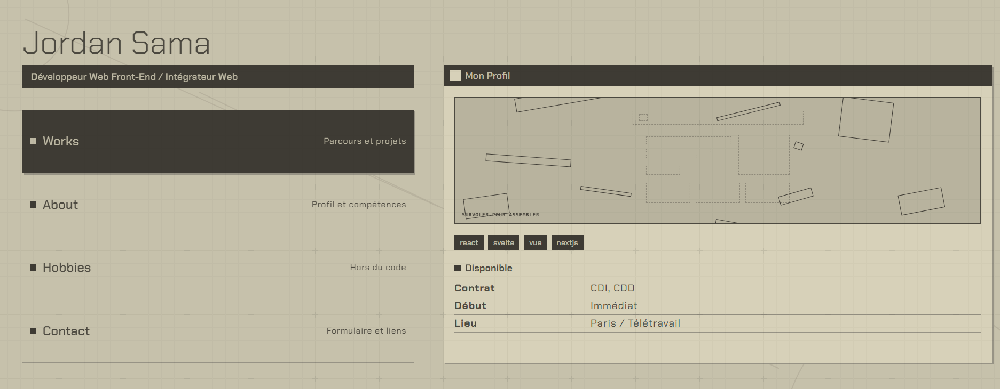

# Portfolio — Jordan Sama

Portfolio personnel de développeur front-end, conçu comme un menu de jeu vidéo
(inspiré de l'esthétique des menus de NieR:Automata).

🔗 **Site :** 



## Fonctionnalités

- Navigation façon menu de jeu, avec barre de description au survol
- Pages : Accueil, About, Works (parcours et projets), Hobbies, Contact
- Animations d'entrée échelonnées, compatibles `prefers-reduced-motion`
- Formulaire de contact avec envoi d'e-mails (Resend), champ anti-spam et limitation d'envois
- Responsive : menu burger sur mobile et tablette
- Aperçu de lien (Open Graph) et favicon personnalisés

## Stack

- [SvelteKit](https://svelte.dev/docs/kit) (Svelte 5) + TypeScript
- [Tailwind CSS](https://tailwindcss.com/) v4
- [Resend](https://resend.com/) pour l'envoi des e-mails
- Tests : Vitest, Playwright · Qualité : ESLint, Prettier

## Installation

```sh
git clone https://github.com/RitoJS/Portfolio.git
cd …
npm install
```

## Configuration

Copie le fichier d'exemple puis renseigne les valeurs :

```sh
cp .env.example .env
```

| Variable             | Description                                         |
| -------------------- | --------------------------------------------------- |
| `RESEND_API_KEY`     | Clé API Resend                                      |
| `CONTACT_TO_EMAIL`   | Adresse qui reçoit les messages du formulaire       |
| `CONTACT_FROM_EMAIL` | Expéditeur, ex. `Portfolio <contact@xxx.xxx.fr>`    |

> Tant que le domaine n'est pas vérifié chez Resend, utilise
> `Portfolio <onboarding@resend.dev>` et ton adresse de compte Resend en destinataire.

## Développement

```sh
npm run dev

# ou en ouvrant directement le navigateur
npm run dev -- --open
```

## Scripts

| Commande          | Rôle                              |
| ----------------- | --------------------------------- |
| `npm run dev`     | Serveur de développement          |
| `npm run build`   | Build de production               |
| `npm run preview` | Prévisualiser le build            |
| `npm run check`   | Vérification des types            |
| `npm run lint`    | ESLint + Prettier                 |
| `npm run test`    | Tests unitaires et composants     |

## Structure

```
src/
├── lib/
│   ├── components/   # Composants réutilisables (blocs, galerie, menu…)
│   ├── mock/         # Données du site (about, works…)
│   ├── server/       # Code serveur uniquement (envoi d'e-mails)
│   └── types/        # Types TypeScript
├── routes/           # Pages (accueil, about, works, hobbies, contact)
└── app.html
static/               # Favicon, image Open Graph, icônes
```

## Déploiement

Le projet utilise `adapter-auto`. Pour un hébergeur précis, installe l'
[adapter](https://svelte.dev/docs/kit/adapters) correspondant et définis les
variables d'environnement ci-dessus sur la plateforme.

## Crédits

- **Développement et design :** RitoJS (Jordan Sama)
- **Icônes :** [SVG Repo](https://www.svgrepo.com/)
- **Police :** [Chakra Petch](https://fonts.google.com/specimen/Chakra+Petch) (SIL Open Font License)


## Licence
